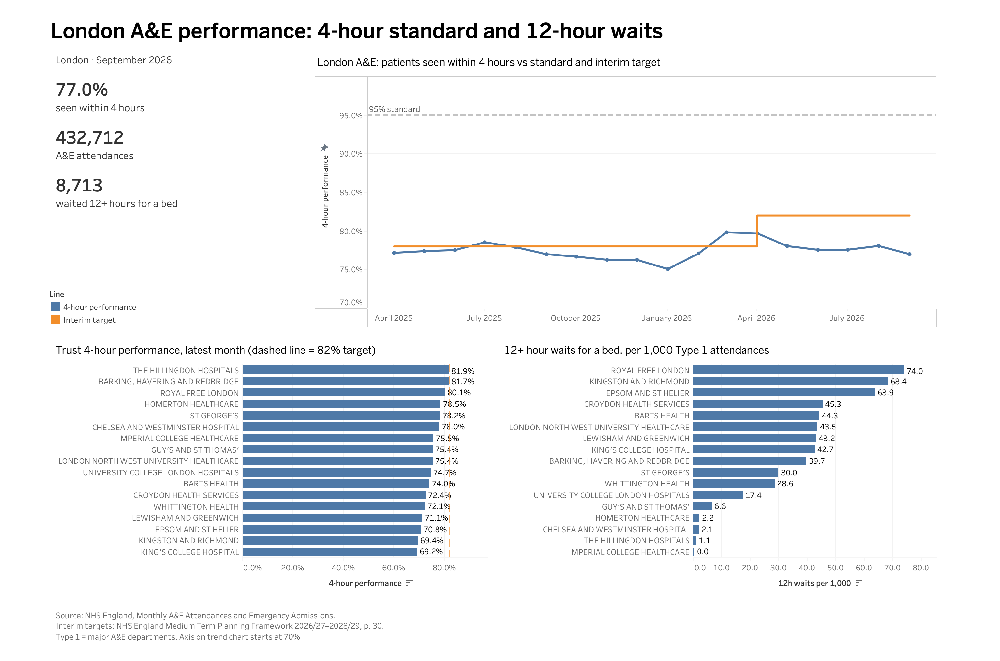

# London A&E Performance Dashboard

How well are London's NHS trusts meeting the 4-hour A&E standard, and how has this changed since April 2025?

This project uses NHS England's monthly A&E data to track London's 4-hour performance against the 95% standard and the interim targets, compare trusts in the latest month, and look at 12-hour waits for a bed. The same figures are built in Excel, PostgreSQL and Tableau and reconciled against NHS England's published totals.



**Interactive dashboard:** [View on Tableau Public](https://public.tableau.com/app/profile/yuzlem.adala/viz/NHSLondonAEPerformance4-HourStandardand12-HourWaits/Dashboard)

**Data coverage:** April 2025 – September 2026 (18 months): the full 2025/26 NHS financial year (April–March) and the first half of 2026/27

---

## Key findings (September 2026)

1. **London has not come close to the 95% standard in any month.** Monthly 4-hour performance ranged from 75.1% (January 2026) to 79.8% (March 2026).
2. **London met the 2025/26 interim target, England did not.** The target was at least 78% in March 2026. London reached 79.8% that month; England as a whole reached 77.1%. Across the rest of 2025/26, London was above 78% only in July 2025 (78.5%).
3. **London is not yet on track for the 2026/27 target.** The target is 82% by March 2027. Between April and September 2026 London stayed between 77% and 80%; in September 2026 it was 77.0% (England: 74.4%).
4. **None of the 17 London trusts with a Type 1 (major) A&E reached 82% in September 2026.** The highest-performing trust was The Hillingdon Hospitals (81.9%) and the lowest-performing was King's College Hospital (69.2%), a gap of 12.7 percentage points.
5. **The two measures tell different stories.** Royal Free London ranks 3rd on 4-hour performance (80.1%) but has the highest rate of 12-hour waits for a bed: 74 per 1,000 Type 1 attendances. Kingston and Richmond is among the lowest on both measures.
6. **Adjusting for trust size changes the ranking.** By count, Barts Health had the 2nd-highest number of 12-hour waits; per 1,000 Type 1 attendances it drops to 5th.

These findings describe what the data shows. They do not explain why performance differs between trusts or months. For example, March 2026 was the highest month for both London and England; this is the month the 2025/26 target was measured, but the data alone cannot show whether the target, the end of winter or other factors caused the peak.

---

## Data

| | |
|---|---|
| Source | NHS England, *A&E Attendances and Emergency Admissions* (monthly provider-level CSV files) |
| Coverage | April 2025 – September 2026 |
| Grain | One row per provider per month |
| Rows | 3,551 raw rows → 3,533 after removing England total rows |
| Region | London = `Parent Org` "NHS ENGLAND LONDON" |

Column definitions, A&E types and how to read each column are in the [data dictionary](docs/data-dictionary.md).

### Measures

| Measure | Definition |
|---|---|
| Total attendances | Type 1 + Type 2 + Other A&E attendances, including booked appointments |
| 4-hour performance | (Total attendances − attendances over 4 hours) ÷ Total attendances |
| 12-hour waits per 1,000 | Patients waiting 12+ hours from decision to admit ÷ Type 1 attendances × 1,000 |
| Type 1 trust | A trust with at least one Type 1 (major) A&E attendance in the month |

Percentages are calculated from totals (weighted), not as averages of trust percentages.

### Targets shown on the dashboard

| Target | Value | Source |
|---|---|---|
| NHS Constitution standard | 95% within 4 hours | NHS England Statistical Commentary, September 2026, p. 2 |
| Interim target 2025/26 | 78% in March 2026 ("a minimum of 78% of patients seen within 4 hours in March 2026") | NHS England, *2025/26 priorities and operational planning guidance*, "Our national priorities for 2025/26" |
| Interim target 2026/27 | 82% by March 2027 ("every trust to maintain or improve to 82%") | NHS England, *Medium Term Planning Framework 2026/27 to 2028/29*, p. 30 |

Interim targets apply to March, the last month of the NHS financial year. The dashboard shows them as a step line from April to March to give a reference for progress during the year; the formal check is the March figure. From 2028/29 the target changes to an average for the whole year (85%).

There is no numeric target for 12-hour waits in 2026/27 (the requirement is improvement on the previous year), so no target line is shown on that chart.

---

## How it works

| Step | Tool | File |
|---|---|---|
| 1. Combine monthly files | Bash | `scripts/combine_months.sh` |
| 2. Single-month analysis and reconciliation | Excel | `analysis/september_2026.xlsx` |
| 3. All-month cleaning, pivot and trend | Excel Power Query | `analysis/london_trend.xlsx` |
| 4. Load raw data | PostgreSQL | `sql/01_load.sql` |
| 5. Clean data (view) | PostgreSQL | `sql/02_clean.sql` |
| 6. Answer five business questions | PostgreSQL | `sql/03_analysis.sql` |
| 7. Data quality checks | PostgreSQL | `sql/04_data_quality.sql` |
| 8. Export clean data | DataGrip | `data/processed/ae_clean.csv` |
| 9. Dashboard | Tableau Public | `tableau/london_ae_dashboard.twb` |

The cleaning was built twice, in Power Query and in SQL, and both versions give the same result. The September 2026 London figure (77.0%) is identical in Excel, PostgreSQL and Tableau.

---

## Data preparation and quality checks

- **Reconciliation:** England totals for September 2026 match NHS England's published figures exactly (2,444,743 attendances; 626,751 over 4 hours). This confirmed that booked appointments are included in the 4-hour measure.
- **Inconsistent total rows:** Each monthly file contains an England total row, but it is not flagged the same way in every file. Most use `Period = "TOTAL"`, two use `"Total"`, February 2026 flags it only in `Org Code`, and one file has a hidden extra character after "TOTAL". A single filter missed some of them; check formulas (Excel `COUNTIF`, SQL `LENGTH`) found them, and all 18 are removed.
- **Text cleaning:** Trailing spaces removed from region names; the text period (e.g. `MSitAE-SEPTEMBER-2026`) converted to a date.
- **Checks in SQL:** no duplicate trust-month rows, no missing totals, 190–200 providers per month (24–25 in London).

Checks are kept in `analysis/london_trend.xlsx` (Checks sheet) and `sql/02_clean.sql` / `sql/04_data_quality.sql`, and are re-run after every update.

---

## Limitations

- Trust-level 4-hour performance combines Type 1 and other A&E types, so trusts with more urgent treatment centre activity can show higher percentages.
- The gap between London and England may partly reflect a different mix of A&E types, not only better performance.
- 12-hour wait counts depend on trust size; a rate per 1,000 Type 1 attendances is shown alongside.
- Imperial College Healthcare reports 0 waits of 12+ hours in September 2026; this may reflect reporting rather than performance.
- The number of London providers changed from 25 to 24 in April 2026; trust comparisons over time should take organisational changes into account.
- Providers with fewer than about 200 attendances or 40 emergency admissions a month are not included in the published data.
- The trend chart's vertical axis starts at 70% to make month-to-month changes visible. Bar charts start at 0%.

---

## How to run

Requirements: Excel (Microsoft 365), PostgreSQL 14+, an SQL client (DataGrip was used), Tableau Public (Desktop Public Edition).

1. Combine the monthly files:
   ```bash
   bash scripts/combine_months.sh
   ```
2. Start PostgreSQL (Homebrew installation):
   ```bash
   brew services start postgresql@14
   ```
3. Create a database (e.g. `nhs_ae`). In `sql/01_load.sql`, update the file path in the `COPY` command to your local copy of `data/processed/ae_all_months.csv`.
4. Run `01_load.sql`, `02_clean.sql`, `04_data_quality.sql`, then `03_analysis.sql`.
5. Export the `ae_clean` view to `data/processed/ae_clean.csv` (with a header row).
6. Open `tableau/london_ae_dashboard.twb` in Tableau Public.

## How to update with a new month

1. Download the new month's CSV from NHS England and save it as `data/raw/ae_YYYY_MM.csv`.
2. Run `bash scripts/combine_months.sh`.
3. Excel: open `analysis/london_trend.xlsx` → **Data → Refresh All** → check the Checks sheet (one more month, 0 total rows, England total matches NHS England).
4. SQL: re-run `01_load.sql` → `02_clean.sql` → `04_data_quality.sql` → `03_analysis.sql`. No dates are hard-coded; "latest month" is found with `MAX(month)`.
5. Re-export `ae_clean.csv` and refresh the Tableau data source. The KPI cards and trust charts move to the new month automatically.
6. Update **Data coverage** and **Key findings** in this README.

---

## Repository structure

```
analysis/        Excel workbooks (single month, all months + checks)
data/raw/        Monthly NHS England CSV files (unchanged)
data/processed/  Combined and cleaned CSV files
data/reference/  NHS system mapping file
docs/            Data dictionary and NHS statistical commentary
images/          Dashboard screenshot
scripts/         Bash script to combine monthly files
sql/             Load, clean, analysis and data quality scripts
tableau/         Tableau workbook
```

## Tools

Excel (Power Query, pivot tables, XLOOKUP, FILTER/SORT/TAKE) · PostgreSQL (views, aggregation, subqueries, CASE WHEN) · Tableau Public (calculated fields, dual axis, dashboard) · Bash · Git

## Sources

- NHS England, [A&E Attendances and Emergency Admissions](https://www.england.nhs.uk/statistics/statistical-work-areas/ae-waiting-times-and-activity/), monthly data April 2025 – September 2026.
- NHS England, Statistical Commentary, September 2026 (copy in `docs/`).
- NHS England (2025), [2025/26 priorities and operational planning guidance](https://www.england.nhs.uk/long-read/2025-26-priorities-and-operational-planning-guidance/), section "Our national priorities for 2025/26".
- NHS England (2025), [Medium Term Planning Framework – delivering change together 2026/27 to 2028/29](https://www.england.nhs.uk/publication/medium-term-planning-framework-delivering-change-together-2026-27-to-2028-29/), p. 30.

---

**Author:** Yuzlem (Ozlem) Adala · [GitHub](https://github.com/adaliozlem)
